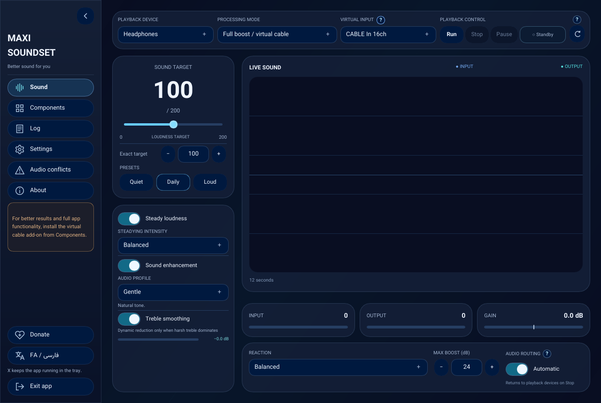
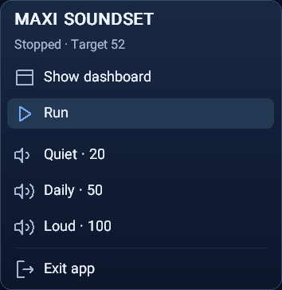
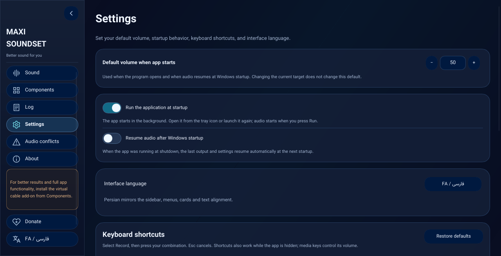
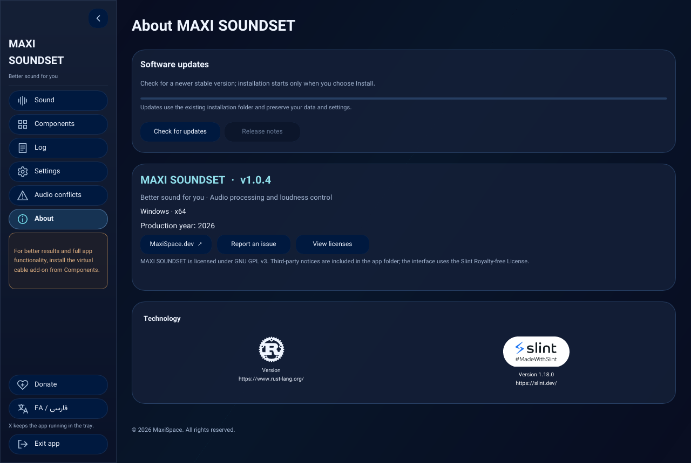
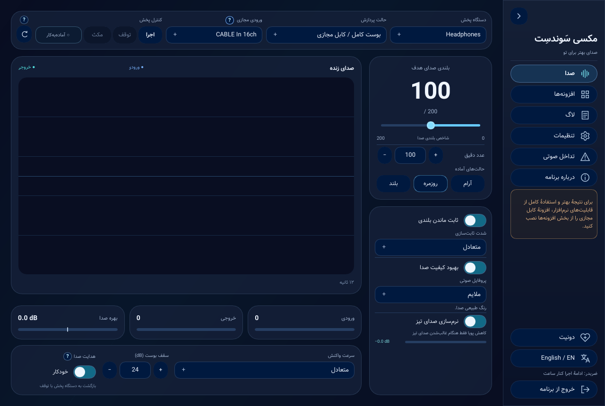
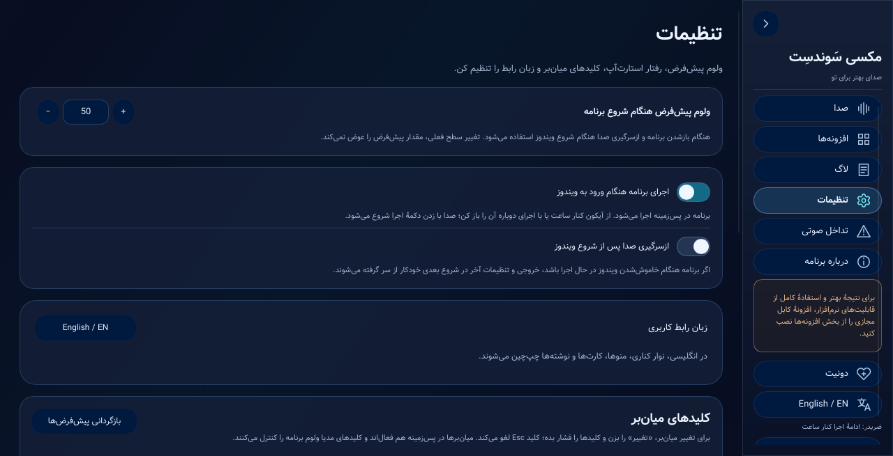
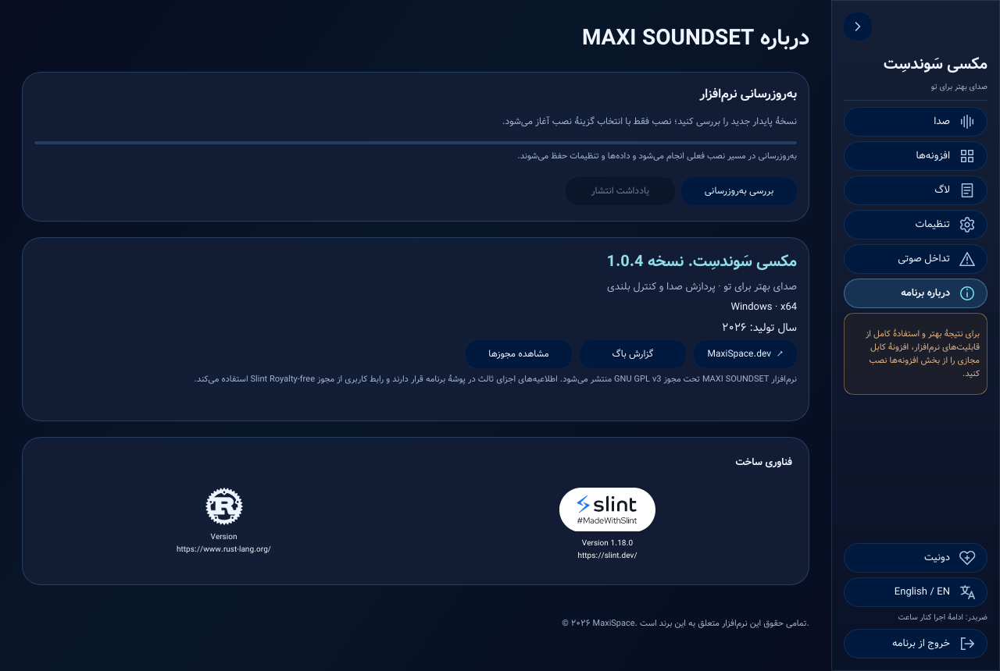

<h1>
   
  MAXI SOUNDSET
</h1>

**Adaptive Audio Processing & Loudness Control for Windows**

 

**[Visit Official Website](https://maxispace.dev/maxisoundset)**

---

<h2>English Version (Click to Expand)</h2>

## 📖 About MAXI SOUNDSET

MAXI SOUNDSET is a Windows app for keeping loudness steady, shaping sound with an equalizer, and monitoring audio as it plays. Version 1.0.4 makes volume easier to control from the tray and improves how the app handles changes to audio devices.

---

## 📸 Screenshots

  
    
  
    
  
    
  

---

## 📥 Download & Installation

*Compatible with Windows 10 & 11 (64-bit)*

1. Download the latest available setup file from the [Releases](../../releases) page.
2. Run the installer and complete the setup.
3. The application can also be launched from its installed folder.

> [!NOTE]
> Setup can ask the app to close safely if it is open in the selected folder. After installation, you can use the Uninstall file in that folder to remove the app.

> [!IMPORTANT]
> Do not remove or relocate any files installed alongside the main executable.

---

## ✨ Features & Highlights

- 🎚️ **Adaptive Volume Stabilization:** Automatically normalizes audio levels with an adjustable reaction speed.
- 🎵 **Audio Smoothing & Enhancement:** Refines sound output, smooths out harsh trebles, and boosts overall audio quality.
- 🎛️ **Dedicated Equalizer:** Features multiple built-in EQ presets alongside a fully manual tuning system.
- 📊 **Real-time Audio Monitor:** Visualizes input and output audio levels instantly.
- 🖱️ **Tray controls:** Scroll over the icon beside the clock to adjust volume, or open its menu to show the dashboard and control playback.
- 🎮 **Customizable Global Hotkeys:** Configure shortcuts to tweak audio settings on the fly while inside other applications or games.
- 🛠️ **Audio Conflict Resolution:** Built-in tools to close or resolve potential audio routing conflicts.
- 🎧 **Output devices:** Pick an output and refresh the list if you reconnect a device.
- 🔀 **Audio routing:** Use Windows volume control or select Full mode for processing through a virtual cable.
- 🔔 **Volume notices:** See changes in a small animated notice that also tells you when processing is paused or stopped.
- 🚀 **Windows Integration:** Run automatically on system startup and resume the last active audio session after sign-in.
- 🌍 **Dual Interface:** Fully supports both English (LTR) and Persian (RTL).

---

## 🔌 Virtual Cable (Optional Component)

By installing this optional component, you unlock advanced audio control and maximum output fidelity:
- 🔊 **Volume Doubling** to safely push levels without harsh clipping.
- ⚖️ **Enhanced Audio Stabilization** for smooth, consistent sound dynamics.
- 🎛️ **Full Equalizer Profiles** tailored for a cleaner, richer acoustic experience.

> [!NOTE]
> Installing the Virtual Cable is optional. However, relying solely on standard Windows audio processing imposes functional limitations within the software.

---

## 🛠️ Troubleshooting & FAQ

**No Sound Output?**
Check the selected playback device. If your headphones have just reconnected, refresh the output list and select them again if needed.

**Closed the App but Still No Sound?**
Sometimes, when you close the software, Windows may keep the default playback device set to the Virtual Cable. You can quickly fix this by clicking the volume icon in your Windows taskbar and changing the output back to your physical speakers or headphones.

**Selecting Audio Inputs:**
In Full mode, open the help beside Virtual Input to see which cable input to use.

**Virtual Cable Routing Setting:**
Ensure the **"Virtual cable routing"** option in the software is set to *Automatic*, unless you are using a different custom audio input and need to configure it manually.

**Virtual Cable Component Issues:**
If you are using the Virtual Cable processing system and facing issues, please double-check that the latest version of this component is correctly installed on your system.

---

## 🤝 Support & Contributing

If you encounter any bugs or have feature requests, please feel free to [open an Issue](../../issues) in this repository.

For direct communication, you can contact me via email:
📧 **info@maxispace.dev**

*Note: If additional communication channels are established in the future, they will be announced here and on the [official website](https://maxispace.dev/maxisoundset).*

---

## 💖 Support & Donate

If you enjoy using MAXI SOUNDSET and want to support its ongoing development, your contribution is greatly appreciated! Every donation helps keep the project alive and growing.

👉 **[maxispace.dev/donate](https://maxispace.dev/donate/)**

---

## 🔄 Updates

The **About** tab lets you check for a new version, view its release notes, and download and install the update when you choose. The installer detects the existing installation folder and preserves settings and shortcuts. Component checks, including VB-CABLE, remain separate from app updates.

---

## 📄 License

MAXI SOUNDSET is licensed under the [GNU General Public License v3.0](MaxiSoundSet-Rust/LICENSE.txt).

 

<h2>نسخه فارسی (برای مشاهده کلیک کنید)</h2>

## 📖 درباره MAXI SOUNDSET

مکسی سوندست برنامه‌ای برای ثابت نگه‌داشتن بلندی صدا، تنظیم صدا با اکولایزر و دیدن سطح صدا هنگام پخش است. در نسخهٔ ۱.۰.۴ کنترل ولوم از کنار ساعت راحت‌تر شده و برنامه تغییر دستگاه‌های صوتی را بهتر تشخیص می‌دهد.

---

## 📸 تصاویر محیط برنامه

  
    
  
    
  
    
  

---

## 📥 دانلود و نصب

*سازگار با ویندوز ۱۰ و ۱۱ (نسخهٔ ۶۴ بیتی)*

۱. تازه‌ترین فایل نصبی موجود را از صفحهٔ [انتشارها (Releases)](../../releases) دریافت کنید.
۲. فایل را اجرا کرده و مراحل نصب را تکمیل کنید.  
۳. برنامه پس از نصب از پوشهٔ محل نصب نیز قابل اجرا است.

> [!NOTE]
> **نکته:** اگر برنامه در مسیر انتخاب‌شده باز باشد، نصاب می‌تواند درخواست خروج امن بدهد. بعد از نصب، فایل Uninstall در همان پوشه برای حذف برنامه در دسترس است.

> [!IMPORTANT]
> **توجه:** فایل‌ها و وابستگی‌های همراه فایل اجرایی در پوشهٔ نصب را به هیچ‌وجه حذف یا جابه‌جا نکنید.

---

## ✨ قابلیت‌ها و ویژگی‌های کلیدی

- 🎚️ **تثبیت تطبیقی صدا (Adaptive Volume Stabilization):** نرمال‌سازی خودکار سطح صدا با قابلیت تنظیم سرعت واکنش.
- 🎵 **نرم‌سازی و بهبود کیفیت صدا:** اصلاح خروجی صدا، نرم‌سازی فرکانس‌های بالای گوش‌خراش (Treble) و ارتقای کلی کیفیت صوتی.
- 🎛️ **اکولایزر اختصاصی:** دارای چندین پریست (Preset) آماده به همراه سیستم تنظیم دستی کامل اکولایزر.
- 📊 **مانیتور لحظه‌ای صدا:** نمایش زنده و در لحظه سطح صدای ورودی و خروجی.
- 🖱️ **کنترل از کنار ساعت:** با اسکرول روی آیکون، ولوم را تنظیم کنید. از منوی همان آیکون هم می‌توانید داشبورد را باز کنید یا پخش را کنترل کنید.
- 🎮 **کلیدهای میانبر سراسری (Global Hotkeys):** امکان تنظیم و تغییر میانبرهای سفارشی برای دسترسی سریع به تنظیمات صوتی از داخل سایر برنامه‌ها یا بازی‌ها.
- 🛠️ **رفع تداخل‌های صوتی:** ابزارهای داخلی برای بستن یا رفع مشکلات احتمالی در مسیردهی صدا.
- 🎧 **دستگاه‌های خروجی:** خروجی را انتخاب کنید و بعد از اتصال دوبارهٔ دستگاه، در صورت نیاز فهرست را تازه کنید.
- 🔀 **هدایت صدا:** از کنترل ولوم ویندوز استفاده کنید یا برای پردازش از طریق کابل مجازی، حالت کامل را انتخاب کنید.
- 🔔 **اعلان ولوم:** تغییر ولوم در یک اعلان کوچک و متحرک دیده می‌شود که وضعیت مکث یا توقف پردازش را هم روشن می‌کند.
- 🚀 **یکپارچگی با ویندوز:** اجرای خودکار با شروع به کار سیستم و بازیابی آخرین وضعیت صوتی پس از ورود به حساب کاربری.
- 🌍 **رابط کاربری دو زبانه:** پشتیبانی کامل از رابط فارسی (راست‌چین) و انگلیسی (چپ‌چین).

---

## 🔌 کابل مجازی (افزونه اختیاری)

با نصب این افزونهٔ اختیاری، به بالاترین بازدهی صوتی و امکانات پیشرفته‌تر دسترسی خواهید داشت:
- 🔊 **دو برابر کردن حجم صدا (Volume Doubling)** بدون افت کیفیت و دیستورشن (بریدگی صدا).
- ⚖️ **پایدارساز صوتی پیشرفته (Audio Stabilizer)** جهت حفظ یکنواختی سطح صدا در برنامه‌ها و فایل‌های مختلف.
- 🎛️ **آزادسازی کامل پروفایل‌های اکولایزر** جهت دریافت صدایی تمیز، غنی و تفکیک‌شده.

> [!NOTE]
> نصب این کامپوننت کاملاً اختیاری است؛ با این حال تکیهٔ صرف بر سیستم پردازش صدای ویندوز، عملکرد نرم‌افزار را با محدودیت‌هایی روبه‌رو می‌کند.

---

## 🛠️ عیب‌یابی و سوالات متداول

**صدای خروجی قطع شده است؟**
دستگاه پخش انتخاب‌شده را بررسی کنید. اگر هدفون تازه دوباره وصل شده، فهرست خروجی‌ها را تازه کنید و در صورت نیاز دوباره آن را انتخاب کنید.

**نرم‌افزار را بسته‌اید ولی هنوز صدا ندارید؟**
گاهی اوقات با بستن نرم‌افزار، ویندوز همچنان دستگاه پخش پیش‌فرض را روی «کابل مجازی» نگه می‌دارد. برای رفع سریع این مشکل، روی آیکون صدا در نوار وظیفه (تسک‌بار) ویندوز کلیک کرده و خروجی را دوباره روی اسپیکر یا هدفون اصلی خود تنظیم کنید.

**انتخاب ورودی‌های صدا:**
در حالت کامل، راهنمای کنار «ورودی مجازی» تفاوت ورودی‌های کابل را توضیح می‌دهد.

**تنظیمات مسیردهی کابل مجازی (Virtual cable routing):**
مطمئن شوید که این گزینه در نرم‌افزار روی حالت *Automatic* (خودکار) تنظیم شده باشد؛ مگر اینکه از یک ورودی صدای متفاوت استفاده می‌کنید و نیاز دارید آن را به‌صورت دستی تنظیم کنید.

**مشکلات مربوط به کابل مجازی:**
اگر از سیستم پردازش صدای کابل مجازی استفاده می‌کنید و با مشکلی مواجه شده‌اید، حتماً بررسی کنید که آخرین نسخه این کامپوننت به درستی روی سیستم شما نصب شده باشد.

---

## 🤝 پشتیبانی و مشارکت

اگر با باگی مواجه شدید یا پیشنهادی برای افزودن قابلیت‌های جدید دارید، خوشحال می‌شوم که یک [Issue ثبت کنید](../../issues).

برای ارتباط مستقیم، می‌توانید از طریق ایمیل زیر با من در تماس باشید:
📧 **info@maxispace.dev**

*توجه: در صورتی که در آینده مسیرهای ارتباطی بیشتری ایجاد شود، در همین بخش و همچنین در [وب‌سایت رسمی](https://maxispace.dev/maxisoundset) اطلاع‌رسانی خواهد شد.*

---

## 💖 حمایت مالی (Donate)

اگر نرم‌افزار MAXI SOUNDSET برای شما مفید بوده و دوست دارید از توسعه و آپدیت‌های آینده‌ی آن حمایت کنید، کمک‌های شما بسیار ارزشمند خواهد بود! هر حمایت مالی به زنده ماندن و رشد این پروژه کمک می‌کند.

👉 **[maxispace.dev/donate](https://maxispace.dev/donate/)**

---

## 🔄 به‌روزرسانی

تب **«دربارهٔ برنامه»** امکان بررسی نسخهٔ جدید، مشاهدهٔ یادداشت انتشار و دانلود و نصب به‌روزرسانی را با انتخاب کاربر فراهم می‌کند. نصاب، مسیر نصب موجود را تشخیص می‌دهد و تنظیمات و میان‌برها را حفظ می‌کند. بررسی اجزای جانبی، از جمله کابل مجازی، مستقل از به‌روزرسانی برنامه است.

---

## 📄 مجوز (License)

نرم‌افزار مکسی سَوندسِت تحت مجوز [GNU General Public License v3.0](MaxiSoundSet-Rust/LICENSE.txt) منتشر شده است.

